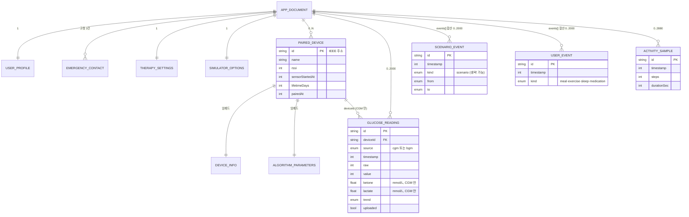

# 데이터 모델 (DB)

전시용 데모 앱 **CGM Test Logger — Medica** 가 다루는 데이터의 정의서임. 코드 기준 원본은 `src/core/types.ts`(타입)와 `src/core/store/appStore.ts`(저장소)이며, 이 문서는 그 둘을 DB 관점(엔티티·필드·키·제약·보존 정책)으로 정리한 것임.

---

## 0. 요약 — 이 앱의 "DB"

이 데모에는 **서버 DB도, SQLite 도 없음**. 상태 전체가 zustand 스토어 하나이고, 그중 일부를 `zustand/middleware` 의 `persist` 가 **단일 JSON 문서**로 직렬화해 AsyncStorage 에 넣음. 즉 "키-값 저장소 1칸 = DB 전체" 구조임.

| 항목 | 값 |
|---|---|
| 엔진 | `@react-native-async-storage/async-storage` (웹: `localStorage`, iOS/Android: 네이티브 KV) |
| 저장소 키 | `cgm-demo-basic-atari` |
| 값 형식 | `{ "state": { …영속 슬라이스… }, "version": 0 }` JSON 문자열 |
| 스키마 강제 | 없음 (TypeScript strict 컴파일 타임만) |
| 트랜잭션 | 없음. `set()` 호출마다 전체 문서 재직렬화 |
| 동시성 | 단일 클라이언트 전용. 멀티 디바이스 동기화 없음 |
| 서버 반영 | `MockUploadService` 가 800 ms 지연 후 성공을 가장함 (실제 전송 없음) |

> 웹 데모에서 데이터를 비우려면 브라우저 DevTools → Application → Local Storage → `cgm-demo-basic-atari` 삭제, 또는 앱의 Settings → 데이터 전체 초기화(`resetAll`).

---

## 1. 엔티티 관계



---

## 2. 루트 문서 스키마

`partialize` 가 고르는 영속 키 17개와, 재시작 때마다 버려지는 휘발 키 5개로 나뉨.

| 키 | 타입 | 영속 | 초기값 | 설명 |
|---|---|:--:|---|---|
| `language` | `Language` | ✅ | `'en'` | UI 언어 |
| `unit` | `GlucoseUnit` | ✅ | `'mg/dL'` | 혈당 표시 단위 |
| `hba1cUnit` | `Hba1cUnit` | ✅ | `'mmol/mol'` | 추정 HbA1c 표시 단위 |
| `viewMode` | `ViewMode` | ✅ | `'glucose'` | Home 카드·차트·Readings 표시 모드 |
| `darkMode` | `boolean` | ✅ | `false` | 다크 팔레트 사용 여부. Settings 의 스위치가 켜고 끔 |
| `therapy` | `TherapySettings` | ✅ | `{70, 180, true}` | 목표 범위·알림 |
| `simulator` | `SimulatorOptions` | ✅ | `{10, 'normal', 1, false}` | 가상 센서 옵션 |
| `autoUpload` | `boolean` | ✅ | `true` | 측정 후 1.5 s 디바운스 자동 업로드 |
| `profile` | `UserProfile` | ✅ | Alex Kim / 42 / 72 kg / 172 cm / other | 사용자 1명 |
| `emergencyContacts` | `EmergencyContact[]` | ✅ | 2건 고정 | SOS 대상 |
| `devices` | `PairedDevice[]` | ✅ | `[]` | 페어링 기기 |
| `activeDeviceId` | `string \| null` | ✅ | `null` | 현재 연결 대상 |
| `readings` | `GlucoseReading[]` | ✅ | `[]` | 측정값 (오래된 것 먼저) |
| `events` | `AppEvent[]` | ✅ | `[]` | 시나리오 전환(`ScenarioEvent`)과 사용자 로그 이벤트(`UserEvent`)가 한 배열에 시간순으로 섞임 |
| `activity` | `ActivitySample[]` | ✅ | `[]` | 걸음 창 |
| `lastReadingAt` | `number \| null` | ✅ | `null` | 마지막 CGM 측정 시각(가상 시계). 재시작 시 `simClock.ensureAtLeast()` 의 하한 |
| `lastUploadAt` | `number \| null` | ✅ | `null` | 마지막 업로드 성공 시각(**실제 시계**) |
| `connection` | `ConnectionState` | ❌ | `'disconnected'` | 링크 상태. 재시작 시 재연결로 복구 |
| `discovered` | `DiscoveredDevice[]` | ❌ | `[]` | 스캔 결과 버퍼 |
| `scanning` | `boolean` | ❌ | `false` | 스캔 진행 중 |
| `uploading` | `boolean` | ❌ | `false` | 업로드 진행 중 |
| `lastUploadError` | `string \| null` | ❌ | `null` | 마지막 업로드 실패 메시지 |

---

## 3. 엔티티 정의

### 3.1 `UserProfile` — 단일 레코드

| 필드 | 타입 | 기본값 | 제약·비고 |
|---|---|---|---|
| `name` | `string` | `'Alex Kim'` | 자유 입력 |
| `age` | `number` | `42` | 정수(년) |
| `weightKg` | `number` | `72` | BMI 계산에 사용 |
| `heightCm` | `number` | `172` | `0` 이면 활동 목표가 30분으로 고정 |
| `gender` | `Gender` | `'other'` | `male` / `female` / `other` |

`activeMinutesGoal()` 이 BMI(= `weightKg / (heightCm/100)²`)로 하루 활동 목표를 정함 — BMI ≥ 25 면 45분, 아니면 30분.

### 3.2 `EmergencyContact` — 고정 길이 2

| 필드 | 타입 | 기본값 |
|---|---|---|
| `name` | `string` | `'Jamie Kim'` / `'Sam Park'` |
| `phone` | `string` | `'010-1234-5678'` / `'010-2345-6789'` |

추가·삭제 액션 없음. `setEmergencyContact(index, patch)` 로 인덱스 지정 수정만 가능함(배열 길이 불변).

### 3.3 `PairedDevice` — 기기

| 필드 | 타입 | 기본값 | 제약·비고 |
|---|---|---|---|
| `id` | `string` | — | **PK**. IEEE 주소 16자리 hex |
| `name` | `string` | 카탈로그 값 | `renameDevice()` 로 변경 가능 |
| `rssi` | `number` | 스캔 시점 값 | dBm. 페어링 후 갱신하지 않음 |
| `info` | `DeviceInfo` | 연결 응답 | 아래 임베드 |
| `algorithm` | `AlgorithmParameters` | `{1.0, 0, 3}` | 아래 임베드 |
| `sensorStartedAt` | `number \| null` | 페어링 시각 | 가상 시계 epoch ms |
| `lifetimeDays` | `number` | `15` | 센서 착용 수명 |
| `pairedAt` | `number` | 페어링 시각 | 가상 시계 epoch ms |

**임베드 `DeviceInfo`**

| 필드 | 타입 | 시뮬레이터 값 |
|---|---|---|
| `manufacturer` | `string` | `'OHC'` |
| `firmwareVersion` | `string` | `'0.8.0'` |
| `ieeeAddress` | `string` | `id` 와 동일 |
| `batteryLevel` | `number` | `100` 에서 시작, 측정 50회마다 −1 % |

**임베드 `AlgorithmParameters`** (Device Profile 화면에서 편집)

| 필드 | 타입 | 기본값 | 역할 |
|---|---|---|---|
| `calibrationSlope` | `number` | `1.0` | 보정 기울기 |
| `calibrationOffset` | `number` | `0` | 보정 오프셋 (mg/dL) |
| `smoothingWindow` | `number` | `3` | 이동평균 창 크기(측정 개수), 최소 1 |

**시뮬레이터 기기 카탈로그** (`SimulatedTransport` 내 `CATALOG`)

| `id` | `name` | 기준 `rssi` |
|---|---|---|
| `08328c8145363b3c` | OHC CGM S1 | −58 dBm |
| `1a7f3e9c02d4b6e8` | OHC CGM S2 | −71 dBm |

스캔 시 `rssi` 에 σ=3 가우시안 잡음을 더해 노출함.

### 3.4 `GlucoseReading` — 측정값

| 필드 | 타입 | 제약·비고 |
|---|---|---|
| `id` | `string` | **PK** |
| `deviceId` | `string` | **FK** → `devices.id`. BGM 수동 입력은 센티널 `'manual'` |
| `source` | `ReadingSource` | `'cgm'` 또는 `'bgm'` |
| `timestamp` | `number` | 가상 시계 epoch ms |
| `raw` | `number` | 보정 전 원시값 (mg/dL). BGM 은 `value` 와 동일 |
| `value` | `number` | **항상 mg/dL 정수**. 표시 단위 변환은 렌더 시점에만 |
| `ketone?` | `number` | 혈중 케톤(β-hydroxybutyrate), mmol/L, 소수 2자리. **CGM 만** — BGM 수동 입력과 구버전 측정값에는 없음 |
| `lactate?` | `number` | 혈중 락테이트, mmol/L, 소수 2자리. **CGM 만** — 위와 동일 |
| `trend` | `Trend` | 혈당 기준 추세. BGM 은 항상 `'unknown'` |
| `uploaded` | `boolean` | 업로드 성공 시 `true` |

**값 계산 (`addCgmReading(deviceId, sample)`)** — `sample` 은 `CgmSample = { raw, timestamp, ketone, lactate }`.

```
recentRaw = [같은 기기의 최근 (smoothingWindow − 1)개 raw, 이번 raw]
value     = round( mean(recentRaw) × calibrationSlope + calibrationOffset )
ketone    = round2(sample.ketone)      // 별도 전극이라 보정·평활화 대상 아님
lactate   = round2(sample.lactate)     // 위와 동일
```

케톤·락테이트는 혈당과 다른 전극에서 나오므로 `calibrationSlope` / `calibrationOffset` / `smoothingWindow` 가 적용되지 않고, 소수 2자리 반올림만 거쳐 그대로 저장됨.

**추세 계산 (`computeTrend` → `classifyTrend`)** — 같은 기기의 CGM 이력에서 3개 전(없으면 직전) 값을 기준으로 측정당 변화량을 구함. 경계는 혈당축 폭(`GLUCOSE_AXIS_RANGE` = 260 mg/dL)에 대한 비율로 정의돼 있어 케톤·락테이트 축에도 같은 사다리가 적용됨(`src/core/util/analyte.ts`).

| 측정당 변화량 (mg/dL) | `trend` | 다이얼 |
|---|---|---|
| > +4.5 | `up` | 12시 |
| +2.5 초과 +4.5 이하 | `upModerate` | 1시 |
| +1 초과 +2.5 이하 | `upSlight` | 2시 |
| −1 이상 +1 이하 | `flat` | 점 3개 |
| −2.5 이상 −1 미만 | `downSlight` | 4시 |
| −4.5 이상 −2.5 미만 | `downModerate` | 5시 |
| < −4.5 | `down` | 6시 |
| 이력 없음 | `unknown` | 점 3개 |

표시용 추세(Home 카드의 다이얼)는 저장된 `trend` 가 아니라, 보고 있는 분석물(혈당·케톤·락테이트)에 대해 `analyteTrend()` 가 최근 4개 측정값으로 매번 다시 계산함. 저장 필드는 CSV 내보내기와 목록 표시용임.

### 3.5 `ScenarioEvent` — 시나리오 전환

| 필드 | 타입 | 비고 |
|---|---|---|
| `id` | `string` | **PK** |
| `timestamp` | `number` | 가상 시계 epoch ms |
| `kind?` | `'scenario'` | 선택 필드. 값이 없으면 시나리오 전환으로 간주(`isScenarioEvent`) |
| `from` | `SimulatorScenario` | 이전 시나리오 |
| `to` | `SimulatorScenario` | 새 시나리오 |

같은 시나리오로의 재설정은 기록하지 않음. Readings 목록·CSV·식후 상승폭 계산의 기준점으로 쓰임.

### 3.6 `UserEvent` — 사용자가 기록한 이벤트

Home 카드의 아이콘 4개로 기록함. `ScenarioEvent` 와 **같은 `events` 배열**에 저장되며, 둘을 합친 타입이 `AppEvent` 임.

| 필드 | 타입 | 비고 |
|---|---|---|
| `id` | `string` | **PK** |
| `timestamp` | `number` | 가상 시계 epoch ms |
| `kind` | `UserEventKind` | `meal` / `exercise` / `sleep` / `medication` — **필수**(이 필드가 시나리오 전환과의 구분자) |

기록하면 저장과 동시에 가상 센서(`glucoseModel`)에 종 모양 임펄스를 넣어 측정값을 실제로 움직임. 겹쳐 기록할 수 있음.

| `kind` | 혈당 피크 | 지속(측정 횟수) |
|---|---|---|
| `meal` | +90 mg/dL | 40 |
| `exercise` | −35 mg/dL | 30 |
| `sleep` | −10 mg/dL | 60 |
| `medication` | −45 mg/dL | 50 |

### 3.7 `ActivitySample` — 걸음 창

| 필드 | 타입 | 시뮬레이터 값 |
|---|---|---|
| `id` | `string` | **PK** |
| `timestamp` | `number` | 창 종료 시각 (가상 시계 epoch ms) |
| `steps` | `number` | 창당 0–8 보 (일상 보행) |
| `durationSec` | `number` | `60` 고정 |

분당 `ACTIVE_STEPS_PER_MIN`(60보) 이상인 창만 "활동 분"으로 셈. 가상 만보기는 최대 8보/분이라 데모에서는 활동 분이 0으로 유지됨 — 네이티브 만보기를 붙이면 채워짐.

### 3.8 `TherapySettings`

| 필드 | 타입 | 기본값 | 범위(UI 스테퍼) |
|---|---|---|---|
| `targetLow` | `number` | `70` | 40 … `targetHigh − 10`, 5 단위 |
| `targetHigh` | `number` | `180` | `targetLow + 10` … 400, 5 단위 |
| `alertsEnabled` | `boolean` | `true` | — |

### 3.9 `SimulatorOptions`

| 필드 | 타입 | 기본값 | 허용값 |
|---|---|---|---|
| `intervalSec` | `number` | `10` | 5, 10, 30, 60, 300 (가상 초) |
| `scenario` | `SimulatorScenario` | `'normal'` | 아래 코드북 |
| `timeScale` | `number` | `1` | `TIME_SCALES` = 1, 2, 5, 10, 50, 100 |
| `paused` | `boolean` | `false` | `true` 면 가상 시계 정지 + 발행 중단(링크는 유지) |

---

## 4. 열거형 코드북

| 타입 | 값 |
|---|---|
| `Language` | `en`, `ko`, `es` |
| `GlucoseUnit` | `mg/dL`, `mmol/L` (표시 변환: `mgdl / 18.016`) |
| `Hba1cUnit` | `mmol/mol`, `%` |
| `Analyte` | `glucose`(mg/dL, 기준 40–300), `ketone`(mmol/L, 정상 ≤0.6, 축 0–3), `lactate`(mmol/L, 정상 ≤2.2, 축 0–8) |
| `ViewMode` | `Analyte` 3종 + `hba1c` — 화면 상단 토글의 GLU / KET / LAC / A1c (칩 라벨만 `A1c`, 저장값은 `hba1c`) |
| `ReadingSource` | `cgm`, `bgm` |
| `Trend` | `up ⇈`, `upModerate ↑`, `upSlight ↗`, `flat →`, `downSlight ↘`, `downModerate ↓`, `down ⇊`, `unknown ·` |
| `UserEventKind` | `meal`, `exercise`, `sleep`, `medication` |
| `ConnectionState` | `disconnected`, `connecting`, `connected` |
| `Gender` | `male`, `female`, `other` |
| `SimulatorScenario` | `normal`(≈105), `meal`(+90 후 복귀), `hypo`(≈55), `hyper`(≈260) — 단위 mg/dL. 모든 시나리오의 기준선에 최대 ±8 mg/dL 의 느린 흔들림이 더해짐 |

---

## 5. 키·무결성·보존 정책

**기본키** — `newId()` 가 생성하는 문자열. 형식 `base36(Date.now())-base36(세션 카운터)-난수4자`, 예: `m1x8k2p-1f-a3q9`. 세션 카운터가 메모리에만 있으므로 재시작 후 같은 밀리초에 다시 1번부터 시작하나, 끝의 난수 4자가 충돌을 막음. UUID 가 아님.

**참조 무결성** — 애플리케이션 레벨에서만 지켜짐.

| 규칙 | 구현 |
|---|---|
| `devices.id` 중복 페어링 금지 | `pairDevice()` 가 기존 id 있으면 no-op |
| `readings.deviceId` → `devices.id` | **CASCADE 없음**. `forgetDevice()` 는 기기만 지우고 측정값은 남김(고아 레코드 허용 — 이력 보존 목적) |
| `readings.deviceId = 'manual'` | BGM 센티널. 어떤 기기도 참조하지 않음 |
| `activeDeviceId` → `devices.id` | `forgetDevice()` 시 `null` 로 되돌리고 `connection` 을 `disconnected` 로 |

**보존 한도** — 전부 FIFO (`slice(-N)`, 오래된 것부터 버림)

| 컬렉션 | 상한 | 환산 |
|---|---|---|
| `readings` | 2 000건 | 10초 간격 기준 약 5.5시간 |
| `events` | 2 000건 | 시나리오 전환 + 사용자 이벤트 합산 |
| `activity` | 2 880건 | 가상 1분/건 → 2일 |

**용량** — JSON 직렬화 기준 측정값 1건 ≈ 180 B(케톤·락테이트 포함), 이벤트 1건 ≈ 65 B, 걸음 1건 ≈ 77 B → 세 컬렉션이 모두 상한일 때 문서 약 0.67 MB. 브라우저 `localStorage` 한도(출처당 5–10 MB) 안쪽임.

**시간축** — `lastUploadAt` 하나만 실제 `Date.now()` 이고, 나머지 모든 `timestamp` 는 **가상 시계(`simClock`)** 기준임. 배속 100x 에서는 가상 시각이 실제 시각보다 한참 앞서므로, 두 축을 섞어 비교하면 안 됨.

---

## 6. 쓰기 경로

| 액션 | 영향 받는 컬렉션 | 비고 |
|---|---|---|
| `addCgmReading(deviceId, sample)` | `readings`, `lastReadingAt` | `sample = { raw, timestamp, ketone, lactate }`. 혈당만 평활화·보정·추세 계산, 케톤·락테이트는 반올림만 |
| `addBgmReading(value, ts?)` | `readings` | `deviceId='manual'`, `raw=value`, `trend='unknown'`, 케톤·락테이트 없음 |
| `logEvent(kind)` | `events` | 사용자 이벤트 1건 append + 가상 센서에 임펄스 주입(`cgmController.logEvent`) |
| `addActivitySample(sample)` | `activity` | 가상 1분마다 |
| `setSimulator({scenario})` | `simulator`, `events` | 값이 실제로 바뀔 때만 이벤트 1건 |
| `pairDevice` / `forgetDevice` / `renameDevice` / `updateDevice` / `setAlgorithm` | `devices` | — |
| `markUploaded(ids)` | `readings.uploaded`, `lastUploadAt`, `lastUploadError` | 업로드 성공 |
| `clearReadings()` | `readings`, `events`, `activity`, `lastReadingAt` | 설정·기기는 유지 |
| `resetAll()` | 전체 | `INITIAL` 로 복귀 (설정 포함) |

업로드는 `autoUpload` 가 켜져 있으면 측정 발생 후 **1.5초 디바운스**(타이머 재설정 없음 — 100x 배속에서 무한 연기 방지)로 `uploadPending()` 을 돌리고, `uploaded = false` 인 전체를 한 번에 보냄.

---

## 7. 저장하지 않는 파생값

아래는 전부 렌더 시점에 계산함. 스토어에 캐시하지 않으므로 DB 스키마에도 없음.

| 파생값 | 정의 | 위치 |
|---|---|---|
| 분석물 기준범위·축 (`AnalyteSpec`) | 혈당은 사용자 목표 범위, 케톤 ≤0.6, 락테이트 ≤2.2 | `util/analyte.ts` |
| 분석물 상태 (`low`/`inRange`/`high`) | 값과 기준범위 비교. 케톤·락테이트는 하한 0이라 `low` 가 나오지 않음 | `util/analyte.ts` |
| 표시용 추세 | 보고 있는 분석물의 최근 4개 측정값으로 매번 재계산 (`analyteTrend`) | `util/analyte.ts` |
| 추정 HbA1c (%) | `(평균 mg/dL + 46.7) / 28.7` (ADAG) | `util/hba1c.ts` |
| 추정 HbA1c (mmol/mol) | `10.929 × (% − 2.15)` (IFCC) | `util/hba1c.ts` |
| 24시간 요약 | `count` / `mean` / `min` / `max` / `timeInRange` | `util/glucoseSummary.ts` |
| 건강 지수 재료 | 활동 분, 걸음 수, 목표 범위 유지율, 식후 상승폭 | `util/healthIndex.ts` |
| 건강 지수 (일간, %) | `0.4 × TIR + 0.3 × 활동달성 + 0.3 × 식후상승점수` | `util/healthIndex.ts` |
| 센서 잔여 기간 | `lifetimeDays − (now − sensorStartedAt) / 86400000` | `util/format.ts` |

---

## 8. 영속 문서 예시

```json
{
  "state": {
    "language": "ko",
    "unit": "mg/dL",
    "hba1cUnit": "mmol/mol",
    "viewMode": "glucose",
    "therapy": { "targetLow": 70, "targetHigh": 180, "alertsEnabled": true },
    "simulator": { "intervalSec": 10, "scenario": "meal", "timeScale": 10, "paused": false },
    "autoUpload": true,
    "profile": { "name": "Alex Kim", "age": 42, "weightKg": 72, "heightCm": 172, "gender": "other" },
    "emergencyContacts": [
      { "name": "Jamie Kim", "phone": "010-1234-5678" },
      { "name": "Sam Park", "phone": "010-2345-6789" }
    ],
    "devices": [
      {
        "id": "08328c8145363b3c",
        "name": "OHC CGM S1",
        "rssi": -56,
        "info": {
          "manufacturer": "OHC",
          "firmwareVersion": "0.8.0",
          "ieeeAddress": "08328c8145363b3c",
          "batteryLevel": 98
        },
        "algorithm": { "calibrationSlope": 1, "calibrationOffset": 0, "smoothingWindow": 3 },
        "sensorStartedAt": 1759795200000,
        "lifetimeDays": 15,
        "pairedAt": 1759795200000
      }
    ],
    "activeDeviceId": "08328c8145363b3c",
    "readings": [
      {
        "id": "m1x8k2p-1f-a3q9",
        "deviceId": "08328c8145363b3c",
        "source": "cgm",
        "timestamp": 1759795210000,
        "raw": 107,
        "value": 106,
        "ketone": 0.21,
        "lactate": 1.04,
        "trend": "flat",
        "uploaded": true
      },
      {
        "id": "m1x8k2p-2a-77bz",
        "deviceId": "manual",
        "source": "bgm",
        "timestamp": 1759795800000,
        "raw": 132,
        "value": 132,
        "trend": "unknown",
        "uploaded": false
      }
    ],
    "events": [
      {
        "id": "m1x8k2p-3c-b1d4",
        "timestamp": 1759795600000,
        "kind": "scenario",
        "from": "normal",
        "to": "meal"
      },
      {
        "id": "m1x8k2p-5e-9h2k",
        "timestamp": 1759795700000,
        "kind": "meal"
      }
    ],
    "activity": [
      { "id": "m1x8k2p-4d-e5f6", "timestamp": 1759795260000, "steps": 5, "durationSec": 60 }
    ],
    "lastReadingAt": 1759795800000,
    "lastUploadAt": 1759795801234
  },
  "version": 0
}
```

---

## 9. CSV 내보내기 스키마

`readingsToCsv()` 가 측정값과 이벤트 타임라인(시나리오 전환 + 사용자 이벤트)을 **하나의 타임라인**(오래된 것 먼저)으로 병합해 RFC 4180 CSV 로 직렬화함. 파일명 `cgm-readings-YYYYMMDD-HHMM.csv`, 줄바꿈 CRLF. 열 14개.

| # | 컬럼 | 측정값 행 | 시나리오 행 | 사용자 이벤트 행 |
|---|---|---|---|---|
| 1 | `timestamp_iso` | ISO 8601 | ISO 8601 | ISO 8601 |
| 2 | `timestamp_ms` | epoch ms | epoch ms | epoch ms |
| 3 | `source` | `cgm` 또는 `bgm` | `scenario` | `event` |
| 4 | `device_id` | 기기 id 또는 `manual` | 빈 값 | 빈 값 |
| 5 | `value_mgdl` | mg/dL 정수 | 빈 값 | 빈 값 |
| 6 | `value_display` | 선택 단위 환산값 | 빈 값 | 빈 값 |
| 7 | `unit` | `mg/dL` 또는 `mmol/L` | 빈 값 | 빈 값 |
| 8 | `ketone_mmoll` | mmol/L (없으면 빈 값) | 빈 값 | 빈 값 |
| 9 | `lactate_mmoll` | mmol/L (없으면 빈 값) | 빈 값 | 빈 값 |
| 10 | `raw_mgdl` | 보정 전 원시값 | 빈 값 | 빈 값 |
| 11 | `trend` | `Trend` 코드 | 빈 값 | 빈 값 |
| 12 | `uploaded` | `true` / `false` | 빈 값 | 빈 값 |
| 13 | `note` | 빈 값 | `scenario <from> -> <to>` | `meal` / `exercise` / `sleep` / `medication` |
| 14 | `id` | 레코드 PK | 이벤트 PK | 이벤트 PK |

`activity` 컬렉션은 현재 CSV 에 포함되지 않음. 시뮬레이터 전용 열(배속 등)도 넣지 않음 — 검증은 `src/core/util/csv.test.ts` 가 맡음.

---

## 10. 서버 DB 전환 설계 (제안)

`UploadService` 를 HTTP 구현으로 바꿀 때 쓸 PostgreSQL(Supabase) 스키마임. **아직 적용된 것이 아니라 설계안**이며, 위의 로컬 문서 모델과 1:1 로 대응됨.

```sql
-- 사용자 ----------------------------------------------------------------
create table patients (
  id            uuid primary key default gen_random_uuid(),
  auth_user_id  uuid unique,                      -- Supabase auth.users 연결
  name          text not null,
  age           smallint check (age between 0 and 130),
  weight_kg     numeric(5,2),
  height_cm     numeric(5,1),
  gender        text check (gender in ('male','female','other')),
  language      text not null default 'en'        check (language     in ('en','ko','es')),
  glucose_unit  text not null default 'mg/dL'     check (glucose_unit in ('mg/dL','mmol/L')),
  hba1c_unit    text not null default 'mmol/mol'  check (hba1c_unit   in ('mmol/mol','%')),
  created_at    timestamptz not null default now()
);

create table emergency_contacts (
  id          uuid primary key default gen_random_uuid(),
  patient_id  uuid not null references patients(id) on delete cascade,
  position    smallint not null check (position between 1 and 2),
  name        text not null,
  phone       text not null,
  unique (patient_id, position)
);

create table therapy_settings (
  patient_id     uuid primary key references patients(id) on delete cascade,
  target_low     smallint not null default 70  check (target_low  between 40 and 400),
  target_high    smallint not null default 180 check (target_high between 40 and 400),
  alerts_enabled boolean  not null default true,
  updated_at     timestamptz not null default now(),
  check (target_high > target_low)
);

-- 기기 ------------------------------------------------------------------
create table devices (
  id                 uuid primary key default gen_random_uuid(),
  patient_id         uuid not null references patients(id) on delete cascade,
  ieee_address       text not null,               -- 로컬 PairedDevice.id
  name               text not null,
  manufacturer       text,
  firmware_version   text,
  battery_level      smallint check (battery_level between 0 and 100),
  last_rssi          smallint,
  sensor_started_at  timestamptz,
  lifetime_days      smallint not null default 15,
  paired_at          timestamptz not null default now(),
  -- 알고리즘 파라미터
  calibration_slope  numeric(6,4) not null default 1.0,
  calibration_offset numeric(6,2) not null default 0,
  smoothing_window   smallint     not null default 3 check (smoothing_window >= 1),
  unique (patient_id, ieee_address)
);

-- 측정값 ----------------------------------------------------------------
create table glucose_readings (
  id           uuid primary key default gen_random_uuid(),
  client_id    text not null,                     -- 로컬 newId(), 재업로드 멱등성 키
  patient_id   uuid not null references patients(id) on delete cascade,
  device_id    uuid references devices(id) on delete set null,  -- BGM 은 null
  source       text not null check (source in ('cgm','bgm')),
  measured_at  timestamptz not null,
  raw_mgdl     smallint not null check (raw_mgdl   between 20 and 600),
  value_mgdl   smallint not null check (value_mgdl between 20 and 600),
  ketone_mmoll  numeric(4,2) check (ketone_mmoll  between 0 and 10),  -- CGM 만, BGM·구버전은 null
  lactate_mmoll numeric(4,2) check (lactate_mmoll between 0 and 20),  -- 위와 동일
  trend        text not null default 'unknown'
               check (trend in ('up','upModerate','upSlight','flat',
                                'downSlight','downModerate','down','unknown')),
  received_at  timestamptz not null default now(),
  unique (patient_id, client_id)                  -- 중복 업로드 방어
);
create index on glucose_readings (patient_id, measured_at desc);
create index on glucose_readings (device_id,  measured_at desc);

-- 시나리오 전환 (데모 전용. 실사용 배포 때는 테이블째 빠지는 자리) ---------
create table scenario_events (
  id          uuid primary key default gen_random_uuid(),
  client_id   text not null,
  patient_id  uuid not null references patients(id) on delete cascade,
  occurred_at timestamptz not null,
  from_state  text not null check (from_state in ('normal','meal','hypo','hyper')),
  to_state    text not null check (to_state   in ('normal','meal','hypo','hyper')),
  unique (patient_id, client_id)
);
create index on scenario_events (patient_id, occurred_at desc);

-- 사용자가 기록한 이벤트 (식사·운동·수면·복약) — 실사용에서도 그대로 남는 쪽 --
create table user_events (
  id          uuid primary key default gen_random_uuid(),
  client_id   text not null,
  patient_id  uuid not null references patients(id) on delete cascade,
  occurred_at timestamptz not null,
  kind        text not null check (kind in ('meal','exercise','sleep','medication')),
  unique (patient_id, client_id)
);
create index on user_events (patient_id, occurred_at desc);

-- 활동 ------------------------------------------------------------------
create table activity_samples (
  id           uuid primary key default gen_random_uuid(),
  client_id    text not null,
  patient_id   uuid not null references patients(id) on delete cascade,
  window_end   timestamptz not null,
  steps        integer  not null check (steps >= 0),
  duration_sec smallint not null check (duration_sec > 0),
  unique (patient_id, client_id)
);
create index on activity_samples (patient_id, window_end desc);

-- 업로드 배치 (감사 로그) ------------------------------------------------
create table upload_batches (
  id            uuid primary key default gen_random_uuid(),
  patient_id    uuid not null references patients(id) on delete cascade,
  reading_count integer not null,
  status        text not null check (status in ('ok','failed')),
  error_message text,
  created_at    timestamptz not null default now()
);
```

**전환 시 고려사항**

- **멱등성** — 로컬 `id`(= `client_id`)에 `unique (patient_id, client_id)` 를 걸고 `insert … on conflict do nothing` 으로 보내면, 업로드 실패 후 재시도에도 중복이 생기지 않음.
- **이벤트 분리** — 로컬은 `events` 배열 하나에 시나리오 전환과 사용자 이벤트를 섞어 두지만(`AppEvent`), 서버에서는 성격이 달라 두 테이블로 나눔. `isScenarioEvent()` 로 갈라 각각 보내면 됨. 시나리오 전환은 데모 산출물이므로 실제 배포에서는 보내지 않아도 됨.
- **케톤·락테이트** — 구버전 측정값에는 없는 선택 필드이므로 서버 컬럼도 `null` 허용으로 두고, 집계 시 `where ketone_mmoll is not null` 로 걸러야 함.
- **시간축** — 로컬 `timestamp` 는 가상 시계값임. 서버로 보낼 때는 실제 시각으로 환산하거나, 데모 데이터임을 표시하는 플래그를 함께 보내야 함.
- **단위** — 저장은 mg/dL 정수로 통일하고 표시 단위는 사용자 설정으로만 둠(현재 로컬 모델과 같은 원칙).
- **RLS** — Supabase 사용 시 모든 테이블에 `enable row level security` 를 켜고 `patient_id` 가 `auth.uid()` 에 매핑되는 정책을 둘 것. 환자 데이터이므로 기본 차단이 전제임.
- **보존** — 로컬의 2 000 / 2 880건 FIFO 상한은 클라이언트 캐시 정책일 뿐임. 서버는 전량 보존하고 클라이언트는 최근 구간만 당겨 쓰는 구조가 맞음.

---

## 11. 스키마 변경·마이그레이션

`persist` 의 `version` 은 `0` 이고 `migrate` 함수를 두지 않았음. 대신 `merge` 가 **깊은 병합**으로 구버전 문서를 흡수함.

```ts
merge: (persisted, current) => ({
  ...current,                                   // 새 빌드의 기본값이 바닥
  ...persisted,                                 // 저장된 값이 덮어씀
  simulator: { ...current.simulator, ...persisted.simulator },   // 중첩 객체는 필드 단위 병합
  therapy:   { ...current.therapy,   ...persisted.therapy   },
  profile:   { ...current.profile,   ...persisted.profile   },
  emergencyContacts: persisted.emergencyContacts ?? current.emergencyContacts,
})
```

따라서 변경 유형별 안전성은 다음과 같음.

| 변경 | 안전한가 | 비고 |
|---|:--:|---|
| 루트에 새 키 추가 | ✅ | `current` 의 기본값이 그대로 들어감 |
| `simulator` / `therapy` / `profile` 에 필드 추가 | ✅ | 깊은 병합 대상 |
| 그 밖의 중첩 객체(`devices[].info` 등)에 필드 추가 | ⚠️ | 배열 요소는 병합되지 않음 — `undefined` 접근 주의 |
| 필드 의미·단위 변경 | ❌ | `version` 을 올리고 `migrate` 를 추가해야 함 |
| 열거형 값 제거 | ❌ | 저장된 구값이 그대로 복원됨 |
| 키 이름 변경 | ❌ | 구값이 버려짐. `migrate` 필요 |

실제 사례 둘 다 같은 수법을 씀 — **새 필드를 선택(`?`)으로 두어 `migrate` 없이 병합만으로 넘어가게** 하는 것.

| 사례 | 필드 | 구버전 문서에서 읽을 때 |
|---|---|---|
| 사용자 이벤트 도입 | `ScenarioEvent.kind?` | 값이 없으면 시나리오 전환으로 간주(`isScenarioEvent`) |
| 케톤·락테이트 도입 | `GlucoseReading.ketone?` / `.lactate?` | `undefined` → 차트·목록에서 해당 측정값을 건너뜀(`analyteValue`), CSV 는 빈 칸 |

둘 다 `version` 을 올리지 않고 넘어갔음. 반대로 기존 필드의 의미·단위를 바꾸는 변경은 이 방식으로 흡수되지 않으므로 `version` + `migrate` 가 필요함.
